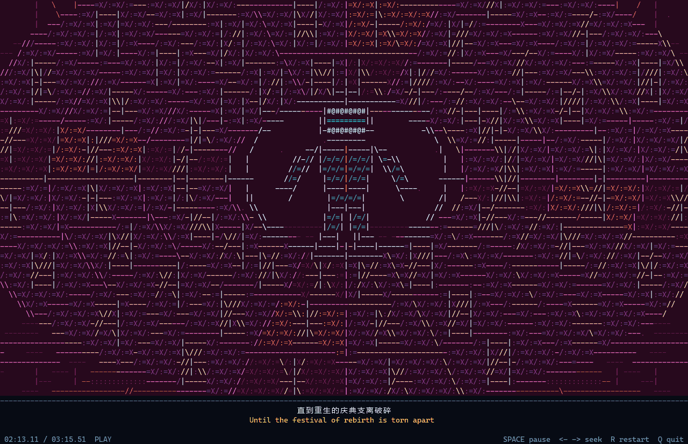

# ÅMARA · 终端 ASCII 字符动画 MV

以《ÅMARA (大未来電脳)》为基础制作的原创字符动画：一个文明把无法理解的输入当作指令执行，语言、记忆、现实和再生机制逐步失控，最后停在 **SYSTEM ERROR**。

全长 **3:15.507**，**65个分镜、55段同步中英字幕**。所有形体由字符和数学过程生成，播放时不载入或转绘官方MV。

[下载1080p完整视频](https://github.com/KhronicleDavid/amara-ascii-mv/releases/latest/download/AMARA-ASCII-MV-1080p.mp4) · [发布页与字幕文件](https://github.com/KhronicleDavid/amara-ascii-mv/releases/latest) · [逐段分镜](storyboard-v2.md) · [本轮动作说明](motion-revision-4.md)



## 当前版本

V2.4 整合最新的22段实体动作修订，以及此前的无缝羁绊、脊骨神经体间奏、机械与全息献花、电子梦毒回廊、旷野、混沌和英文重连场景。

- **2:15的“支离破碎”**：机械人形先失去连接，裂纹扩散到三层光冠；独立构件绕不同轴翻转、迎面飞散，祭坛与悬索随后崩断。第二次同句改为重建桥片屈曲、圣堂向内塌落。
- **1:43前后的识读失败**：石刻扫描、笔画逃逸、文明接入光学译码器、节点断线、记录翻页、城市压毁和递归反馈炸裂，各自有明确动作结果。
- 语言膜卷曲剥离，镜片绕铰链张开，织线撕开回弹，城市断面翻转，虚构地图合拢，互斥解释相撞，天国穹顶倒扣，三维坐标网逐级断焊。
- **1:52.218直接进入混沌**；1:53开始先慢后快地压缩，1:56.780成为单根丝线；保持到2:00.700后，全屏闪烁英文巨字 **RECONNECT**，周围链路、握手与同步过程逐步恢复。
- 33.841–44.500秒依据原MV字卡补入「ヒカリナクモアレ」：**即使无光，也愿存在。** 原LRC保留。

字幕与动画按同一条音乐时间推进；暂停、跳转、重播使用音乐设备的实际播放位置。重复歌词采用不同构图与动作，结尾保留“这个系统发生了严重错误”的立意。

## 在终端播放

支持 Windows 10/11。准备 Python 3.11 或更新版本，然后运行：

```powershell
git clone https://github.com/KhronicleDavid/amara-ascii-mv.git
cd amara-ascii-mv
python -m pip install -r requirements-build.txt
python prepare_assets.py
python amara.py
```

首次准备会把仓库中的FLAC解码为本机WAV缓存，并生成音乐分析数据。准备完成后，日常播放只使用Python标准库；也可以双击 `play.cmd`。

建议 Windows Terminal 全屏，约 **160列 × 47行**或更大，使用 Cascadia Mono。画面会随窗口尺寸调整，中文由系统后备字体显示。

| 操作 | 按键 |
|---|---|
| 暂停 / 恢复 | Space |
| 后退 / 前进5秒 | ← / →，或 A / D |
| 从头开始 | R |
| 退出 | Q / Esc / Ctrl+C |

```powershell
python amara.py --start 102.266
python amara.py --start 133.114
python amara.py --start 166.518
python amara.py --mute --size 160 46
python amara.py --subtitle-offset 0.15
```

## 渲染完整视频

```powershell
python -m pip install -r requirements-render.txt
python render_video.py
```

默认导出 `outputs/AMARA-ASCII-MV-1080p.mp4`：**1920×1080、30fps、H.264、AAC立体声**，包含原音乐、放大的中英字幕和65个场景章节。同时生成双语SRT、章节信息及渲染报告。

视频直接绘制当前字符帧，去掉终端的时钟和操作提示。每帧由歌曲时间直接计算，不受实时播放速度影响。渲染器的字符合成已经与终端预览逐像素比对。

```powershell
python render_video.py --samples-only
python render_video.py --start 133.114 --duration 3.66 --output outputs/fracture.mp4
python render_video.py --encoder h264_nvenc
python render_video.py --ffmpeg C:\Tools\ffmpeg\bin\ffmpeg.exe
```

已有同名视频时不会覆盖。FFmpeg可由 `imageio-ffmpeg` 提供，也可从PATH或 `--ffmpeg` 指定；硬件编码选项需要兼容的NVIDIA显卡。

## 预览与结构

- [最新22段动作剪辑，静音](previews/scenes_revision_4/montage.gif)
- [1:42–1:52连续识读段落，静音](previews/scenes_revision_4/inscription-sequence.gif)
- [22段画面总览](previews/scenes_revision_4/contact-sheet.png)
- [全片40个代表画面](previews/v2/contact-sheet.png)
- [英文重连特写，静音](previews/reconnect_english/preview.gif)

| 文件 | 内容 |
|---|---|
| `amara.py` | 终端画布、字幕排版与播放循环 |
| `cinema.py` | 65个分镜、混沌、丝线、RECONNECT与终局 |
| `revised_scenes.py` | 无缝羁绊、神经体、未知未来、献花与梦毒 |
| `kinetic_scenes.py` | 实体碎裂、铭文识读、卷曲、铰链与空间解体 |
| `audio.py` | Windows音乐设备与播放时钟 |
| `subtitles.json` | 55条中英字幕与补词说明 |
| `prepare_assets.py` | 本机音乐缓存与特征分析 |
| `render_previews.py` / `render_video.py` | 实际字符帧的图片、动图与完整视频导出 |

## 检查与构建

```powershell
python amara.py --check
python -m unittest discover -s tests -v
python render_previews.py --gallery --gif
python tools/update_storyboard.py
```

当前场景修订通过四种窗口尺寸的6,340帧检查，最终神经圣堂背景另复核920帧；55条字幕与65个分镜切点保留。10项播放时钟、跳转、清理和缓存回归检查通过。

如需自行构建Windows独立播放器：

```powershell
python -m pip install pyinstaller
python tools/build_release.py
python tools/verify_release.py
```

## 制作与参考

词曲：**sasakure.UK**；演唱：**KAITO / 初音ミク**。原始音乐与日文歌词归相应创作者所有；本项目保留输入音乐和原LRC，中英字幕依据提供的歌词及官方MV字卡制作。

场景参考官方MV的意象、尺度与音乐段落，独立编写字符几何、运动与分镜。布局审美参考 [world.execute-me-ascii](https://github.com/yym8224961/world.execute-me-ascii/blob/main/README.md) 的满幅构图和大字排布。
